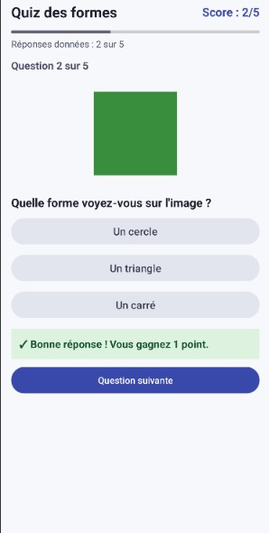
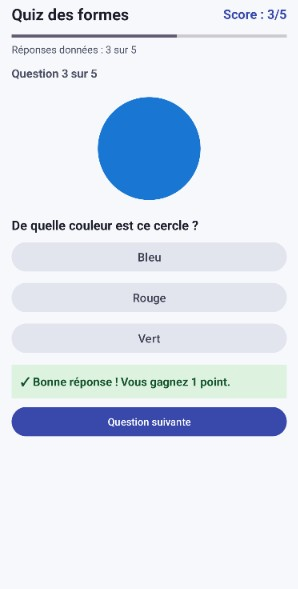
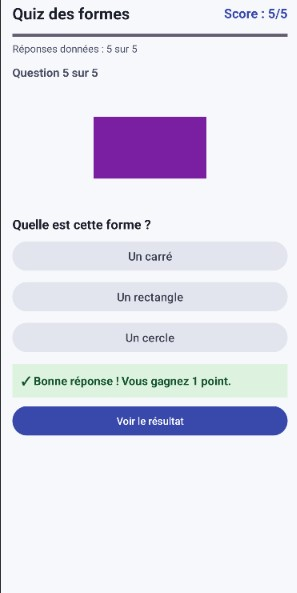

# Quiz en images — TP Android

Jeu de cinq questions sur les formes géométriques (triangle, carré, cercle, étoile, rectangle), écrit en Kotlin avec une interface XML et une seule activité. Pour chaque question, on observe une image puis on choisit l'une des trois réponses. Une bonne réponse rapporte 1 point et la barre de progression compte les réponses données.

## Accès rapide

| Élément | Emplacement |
|---|---|
| Code Kotlin | [`app/src/main/java/com/example/quizimages/`](app/src/main/java/com/example/quizimages/) |
| Interface XML | [`app/src/main/res/layout/activity_main.xml`](app/src/main/res/layout/activity_main.xml) |
| Images des questions | [`app/src/main/res/drawable/`](app/src/main/res/drawable/) |
| Captures d'écran | [`captures/`](captures/) |
| Compte rendu | [`compte-rendu/compte_rendu.md`](compte-rendu/compte_rendu.md) |

## Ouvrir et lancer l'application

1. Cloner le dépôt ou décompresser le projet.
2. Dans Android Studio, choisir **File > Open** puis sélectionner le dossier du projet.
3. Attendre la fin de la synchronisation Gradle.
4. Choisir un émulateur ou un téléphone (Android 7.0 ou plus récent), puis cliquer sur **Run ▶**.

En ligne de commande, sous Windows : `gradlew.bat assembleDebug`. Sous Linux ou macOS : `./gradlew assembleDebug`.

**Configuration utilisée :** Android Gradle Plugin 9.4.1, Gradle 9.6.0 (fourni par le Gradle Wrapper), compileSdk 37, minSdk 24.

## Captures d'écran

